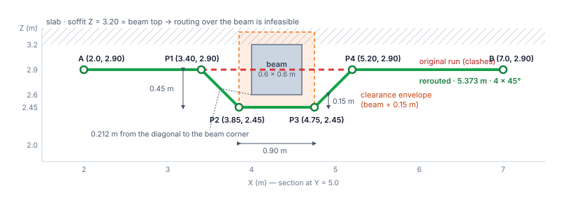
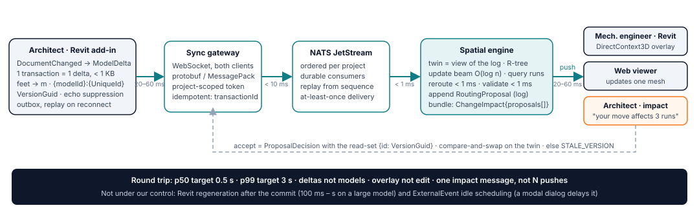
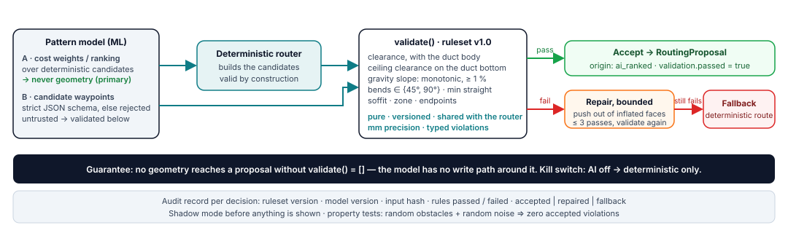

# Real-Time MEP Coordination — Design & Algorithmic Spike

**Elnatan Davidovitch** · elnatan1990@gmail.com · 050-6998223 · [linkedin.com/in/elndav](https://www.linkedin.com/in/elndav)
Companion: **[interactive page](https://maof-mep.vercel.app)** (3-D scene — move the beam yourself) · **[PDF](docs/MEP-Coordination-Spike.pdf)** · [תקציר בעברית (PDF)](docs/MEP-Coordination-Spike-HE.pdf) · `python -m routing` prints every number quoted below.

**Assumptions.** MEP = the mechanical, electrical and plumbing services of a building (ducts, pipes, cable trays). (1) The beam is a downstand flush with the slab: its top (Z = 3.20 m) is the soffit (the underside of the slab), so routing *over* it is infeasible. (2) The suspended-ceiling height `Z_c` comes from the architectural model; the exercise gives none, so the worked example leaves it open, and a second case shows the ceiling becoming the limit. The void between the ceiling and the slab is the plenum. (3) The exercise's duct is a centre-line (no thickness); a real 400 × 300 mm insulated duct is the second case. (4) All values are in metres, in the project's shared coordinates; the Revit add-in ("the plugin") converts from Revit's internal unit, feet. (5) The architect moves the beam +0.40 m in X.

## 1. Spatial routing — a deterministic line-probe router, with a validator as the final check

**Representation.** Obstacles are axis-aligned boxes inflated by *clearance + the duct's half-extent in the bend plane*: a conservative Minkowski sum, meaning the obstacle is grown by the duct's size so the duct can be treated as a line, and it is kept a box rather than a rounded box. A 45° diagonal leaving an inflated corner keeps clearance × √2 = 0.15 × √2 ≈ 0.21 m from the real corner, so the box is safe for diagonals too. Everything is snapped to and compared at millimetres, so "exactly 15 cm" is a clean pass, not a rounding accident.

**Why a geometric offset, not a search.** Ducts are axis-aligned with 45°/90° fittings, and a moved beam is one blocker on a straight run. For that case an analytic *line probe* (the Hightower / Mikami–Tabuchi family: classic circuit-board wire routers that cast straight lines past obstacles) is exact, deterministic and sub-millisecond:

1. **Probe** — does the straight run penetrate the inflated box? No → keep it.
2. **Candidates** — under, over, left, right, each with an explicit feasibility test (c = clearance, h = the duct's half-height, c_ceiling = a 0.02 m margin above the ceiling). Under: `z = beam_bottom − c − h`, feasible only if `z − h − c_ceiling ≥ Z_c`; over: `z + h + c ≤ soffit`; lateral: the route must stay inside the zone (the allowed routing volume). None may cut a second obstacle; a gravity pipe may never rise.
3. **Waypoints** — a 45° trapezoid (or 90° rectangle) between the inflated faces; cost = added length + 0.25 m per bend; the cheapest wins, ties break in a fixed order, so the result is stable.
4. **No feasible candidate → `NO_ROUTE(PLENUM_TOO_SHALLOW)`** and a coordination issue for the structural engineer, in BCF (the open BIM issue-exchange format): a sleeve through the beam, a local bulkhead, or moving the beam. A coordination tool must say *why* there is no route.
5. **Validate** — the rule set the AI gate uses (§3) checks the router's own output.

| approach | deterministic | bends | latency (estimates, one plenum zone) | note |
| --- | --- | --- | --- | --- |
| **geometric offset** (chosen: one blocker) | yes | 45°/90° by construction | < 1 ms | exact; one obstacle per probe |
| sparse orthogonal graph + A\* with a turn penalty (the generalisation) | yes | orthogonal, then a chamfer pass (each 90° step becomes a 45° offset) | 1–30 ms | nodes only at inflated face coordinates; state = (node, direction) |
| A\* on a 5 cm voxel grid (a 3-D grid of 5 cm cubes) | yes | staircase → smoothing | 50 ms – 2 s; 800k voxels per 10 × 10 × 1 m | resolution fights clearance accuracy |
| 3-D visibility graph | yes | arbitrary angles | ms | shortest path among 3-D polyhedra is NP-hard (no known fast exact method); a graph through obstacle corners is only an approximation |
| RRT\* (random-sampling tree planner) | no (sampled) | random → smoothing | 100 ms – s | built for many-jointed robot arms, not ducts |

*With more time:* Tier 2 is the sparse graph, run only when the probe meets a second obstacle; its chamfer post-pass turns each Z-step into a 45° offset so both tiers emit the same fitting style.



**Worked result** for the beam as given, before the +0.40 m move (`python -m routing`): inflated box X ∈ [3.85, 4.75], Z ∈ [2.45, 3.35]; over is infeasible (soffit), lateral is outside the zone (the beam spans all of Y) → **under**:
`A (2.0, 5.0, 2.90) → (3.40, 5.0, 2.90) → (3.85, 5.0, 2.45) → (4.75, 5.0, 2.45) → (5.20, 5.0, 2.90) → B (7.0, 5.0, 2.90)` — **5.373 m** (+0.373 m, +7.5 %), four 45° fittings, clearance 0.150 m on the flat run and 0.212 m at the diagonals. The 90° variant is 5.90 m (+18 %) with the same four fittings: 45° wins on length and pressure loss. A two-bend "V" would need 11–14° legs and passes 0.09 m from the beam: rejected. Real section (400 × 300 mm, 25 mm insulation, 15 mm flange, h = 0.19 m half-height): centre-line at 2.26 m, duct bottom at 2.07 m — feasible only if the ceiling is at or below 2.05 m (2.07 m minus the 0.02 m ceiling margin); with a ceiling at 2.70 m the answer is `NO_ROUTE`. After the +0.40 m move the topology is preserved: the same shape, four waypoints shifted in X.

```text
reroute(run, obstacles, c):                              # routing/reroute.py, ~60 lines of logic
    box = first obstacle whose inflated box the straight run penetrates
    if box is None: return straight
    for side in (under, over, left, right):              # fixed order = stable tie-break
        inf    = box.inflated(c.clearance + run.section.half_in_plane(side))
        target = inf.face(side);  d = |target - run.level|;  lead = d if c.bend == 45 else 0
        pts    = [A, A.at(inf.entry - lead), (inf.entry, target), (inf.exit, target), B.at(inf.exit + lead), B]
        if not feasible(side, target, ceiling, soffit, zone, other_obstacles, min_straight): note reason; continue
        cost[side] = length(pts) - |AB| + 0.25 * bends(pts)
    best = argmin(cost) or NO_ROUTE(reason of the preferred side)
    assert validate(best.pts) == []                      # the gate's rule set, applied to ourselves
```

## 2. Real-time data flow — a 40 cm beam move, Revit-native



1. **Capture (the plugin).** `Application.DocumentChanged` fires after the architect's transaction commits (Added/Modified/Deleted ids). Filter to geometric categories and the primary design option; compare `Element.VersionGuid` (Revit's per-element change stamp) and a hash of the bounding box, so edits that change parameters but not geometry are dropped. **One transaction = one `ModelDelta`**, applied atomically to the twin (the cloud's lightweight copy of the model geometry). No debounce timer (a move is already one transaction); deltas for the same element are merged only while an earlier one is still in transit. Feet → metres via `UnitUtils`, shared coordinates via `ActiveProjectLocation.GetTotalTransform()`; identity `{modelId}:{UniqueId}`, version `VersionGuid`. Echo suppression: our own accepted-proposal transactions are recognised by name and not re-sent. A `DocumentChanged` event yields a *live preview* proposal; `DocumentSynchronizedWithCentral` (the architect syncing to the shared central model) makes it *committed*. The beam lives in the structural model, a separate RVT file that the mechanical engineer sees as a link refreshed only on reload: the twin bridges that gap (a ghost of the moved beam plus the rerouted duct before the reload, re-validation against the authoritative geometry after it).
2. **Transport.** WebSocket + protobuf/MessagePack (compact binary encodings) for *both* desktop and web. Why not gRPC: Revit add-ins run on .NET Framework 4.8 and share one AppDomain (one in-process sandbox), so `Grpc.Net.Client`/`Google.Protobuf` clash with other vendors' add-ins, and HTTP/2 bidirectional streaming there needs WinHttp on Windows 11. In the browser, grpc-web has no client streaming. gRPC stays service-to-service inside the cloud.
3. **Cloud.** Gateway (project-scoped tokens, access rules per subject) → **NATS JetStream** (a durable, replayable message stream), partitioned by project (events are ordered per project; a zone only decides who receives an update, not the order) → spatial engine. The *twin* is a materialised view of the event log (the current state, computed from the stored sequence of changes): bounding volumes + centre-lines, ~100 B per element, 50k elements ≈ 5 MB, rebuilt from the log on failover, held in an R-tree (a spatial index for boxes). Update the beam in O(log n), query the runs that intersect the old or the new inflated box, reroute, validate, append a `RoutingProposal`. Delivery is at-least-once (a message may arrive twice, never zero times), so the consumer is idempotent: a repeat with the same (id, VersionGuid) is ignored. One beam move affecting many runs (even 200) becomes **one `ChangeImpact{proposals[]}`**, pushed to the mechanical engineer *and* to the architect: "your move affects 3 runs" is the most valuable real-time signal in the product.
4. **Apply (the plugin).** An `ExternalEvent` (Revit's hook for running add-in code when Revit is idle) draws the proposal as a DirectContext3D overlay (temporary graphics, not model elements); the Revit model is not edited until the engineer accepts. Accept is a **compare-and-swap on the proposal's read-set** `{elementId: VersionGuid}`: it succeeds only if the beam, the duct and the other obstacles are still at the versions the route was computed from; otherwise it returns `STALE_VERSION` and the client requests a fresh route. On reconnect, the plugin sends its outbox (changes queued while offline) and replays from the last acknowledged sequence number, or loads a zone snapshot if the log has been compacted (old entries pruned).
5. **Within seconds, nothing freezes.** Deltas (< 1 KB), never models (100 MB – 2 GB); the heavy model never leaves the client; an overlay, not an edit; one impact message, not N pushes; an incremental index. Budget (estimates, all in ms): extract 5–20 · upload 20–60 · bus < 10 · index < 1 · route < 1 · validate < 1 · persist ~5 · push 20–60 · apply 10–30 → **p50 target 0.5 s, p99 target 3 s** (half of all moves under 0.5 s, 99 in 100 under 3 s). Not under our control: Revit's regeneration after the commit (100 ms to seconds on a large model) and `ExternalEvent` idle scheduling (a modal dialog delays it).

## 3. AI safety gate and the API contract



**The guarantee comes from what the model may output.** The pattern model (the ML component that learns routing preferences from past projects) emits *cost weights or a ranking over deterministic candidates* — never geometry — so whatever it outputs, the result is a route the router built and validated. In the second, weaker-guarantee mode (the model proposes waypoints in a strict JSON schema) the same `validate()` runs: clearance with the duct body, ceiling clearance on the duct *bottom*, gravity slope (monotonic, ≥ 1 %), bends ∈ {45°, 90°}, minimum straight length between fittings, soffit, zone, endpoints. Fail → bounded deterministic repair (push waypoints out through the nearest inflated face, three passes) → re-validate → otherwise **fallback** to the deterministic route, valid by construction. Every decision writes an audit record (ruleset version, model version, input hash, rules passed and failed). Shadow mode first (the model runs and is logged, but its output is not shown), a kill switch, and property tests: random obstacles + random perturbations ⇒ zero accepted violations (`tests/`).

**Contract** ([`schema/`](schema), examples in [`schema/examples/`](schema/examples)): `schemaVersion`, metres, shared coordinates, ids `{modelId}:{UniqueId}`, versions = `VersionGuid`, `requestId`/`transactionId` as idempotency keys (a resent message with the same key is processed only once). `ModelDelta` (plugin → engine, one committed transaction) · `RerouteRequest` → `RerouteResponse` (sync) · `RoutingProposal` inside a `ChangeImpact` (push) · `ProposalDecision` (accept/reject with the read-set, plus the created element ids) · `Error {code: NO_ROUTE | STALE_VERSION | INVALID_INPUT, message, details}`.

```json
// RerouteRequest (trimmed)
{ "schemaVersion": "1.0", "requestId": "req-01HZX4M2Q9", "projectId": "prj-7f2a",
  "run": { "id": "duct-1", "systemType": "duct", "start": [2.0, 5.0, 2.9], "end": [7.0, 5.0, 2.9],
           "targetElementIds": ["MEP-L03:7b1c2d3e-…-0001a2b3"], "size": "400x300", "system": "Supply Air" },
  "constraints": { "clearance_m": 0.15, "bendAngles": [45, 90], "preferredBend": 45, "minStraight_m": 0.30,
                   "soffitZ": 3.2, "zone": { "min": [0, 0, 2.0], "max": [10, 10, 3.2] } },
  "obstacles": [ { "id": "STR-L03:0a1b2c3d-…-000e1f20", "versionGuid": "0c2f8e1a-…",
                   "bbox": { "min": [4.0, 0, 2.6], "max": [4.6, 10, 3.2] } } ] }
```

```json
// RerouteResponse (trimmed) — the script's own output for the request above
{ "schemaVersion": "1.0", "requestId": "req-01HZX4M2Q9", "status": "ok", "side": "under",
  "waypoints": [[2.0,5.0,2.9], [3.4,5.0,2.9], [3.85,5.0,2.45], [4.75,5.0,2.45], [5.2,5.0,2.9], [7.0,5.0,2.9]],
  "fittings": [ { "at": [3.4,5.0,2.9], "angleDeg": 45 }, { "at": [3.85,5.0,2.45], "angleDeg": 45 },
                { "at": [4.75,5.0,2.45], "angleDeg": 45 }, { "at": [5.2,5.0,2.9], "angleDeg": 45 } ],
  "metrics": { "length_m": 5.373, "added_m": 0.373, "bends": 4, "min_clearance_m": 0.15 },
  "validation": { "passed": true, "rulesetVersion": "1.0", "violations": [] },
  "readSet": { "STR-L03:0a1b2c3d-…-000e1f20": "0c2f8e1a-…", "MEP-L03:7b1c2d3e-…-0001a2b3": "9a8b7c6d-…" },
  "candidates": [ { "side": "under", "feasible": true, "cost_m": 1.373 }, { "side": "over", "feasible": false, "reason": "SOFFIT_TOO_LOW" },
                  { "side": "left", "feasible": false, "reason": "OUTSIDE_ZONE" }, { "side": "right", "feasible": false, "reason": "OUTSIDE_ZONE" } ] }
```

**Delegation.** *Plugin (hers, the Revit-plugin developer's):* event capture and filtering, delta extraction and unit conversion, the overlay; on accept, create the `Duct` elements and one `NewElbowFitting` per entry in `fittings[]`; echo suppression, the outbox. *Engine (mine):* gateway, twin, router, validator, persistence, push. *Shared:* the schemas, the example fixtures, a contract test that both teams' CI pipelines run, and a **mock engine** (static JSON from `schema/examples/`) so the plugin is built and demoed before the engine exists.

---

```bash
python -m routing                    # the exercise: waypoints, metrics, candidates, validator verdict
python -m routing --scenario moved   # +0.40 m; also: ninety, real-section, real-low, gravity, no-soffit  (--all --json)
python -m pytest                     # 22 tests: the quoted numbers, feasibility, the gate, the contract examples
```

`routing/reroute.py` the router and geometry · `routing/validate.py` the rules and `safety_gate()` · `routing/scenarios.py` the exercise and variants · `schema/` the contract · `docs/` the PDFs and diagrams · `web/` the companion page (optional, built after the time-box; every number in it comes from the script).
